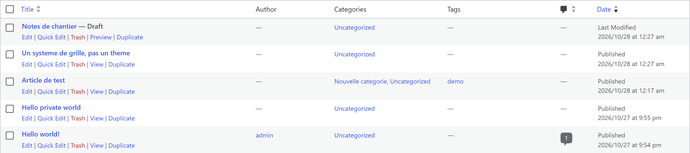
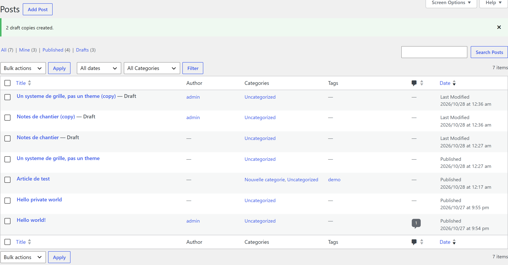
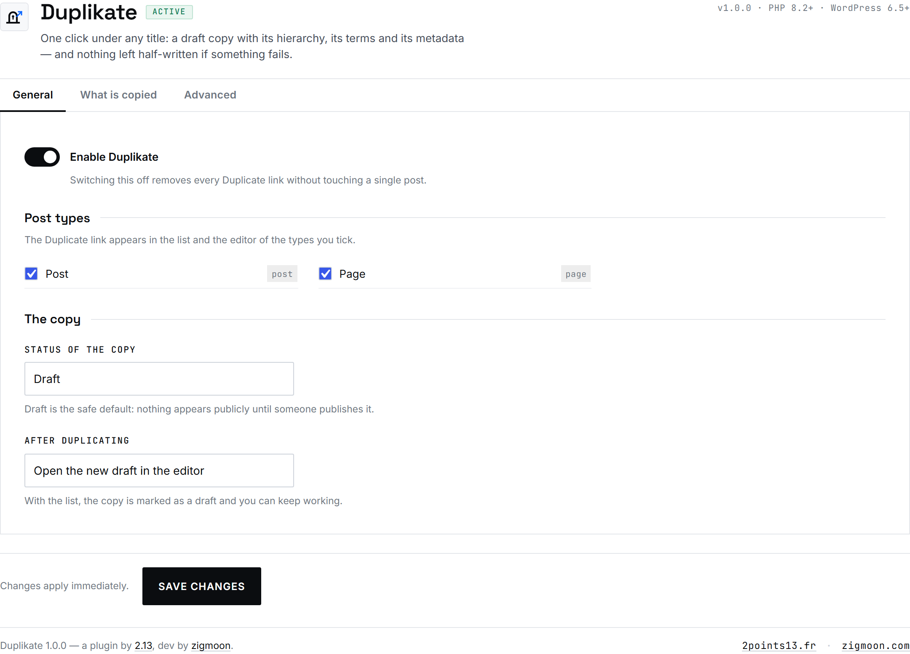
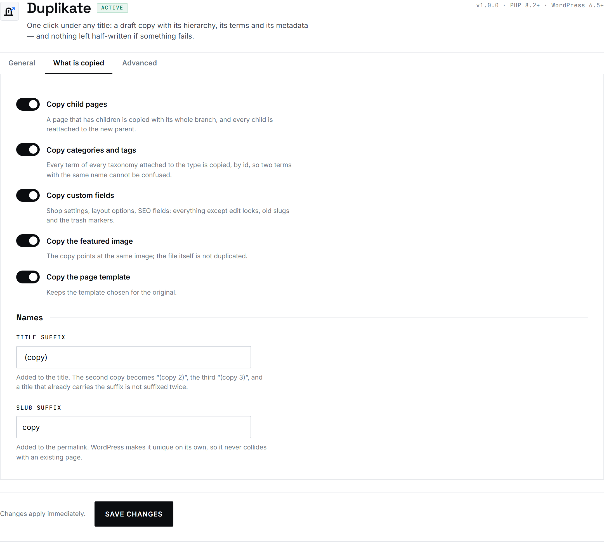
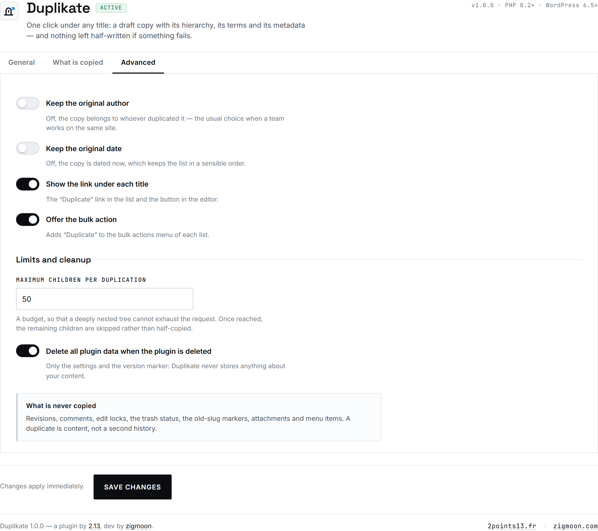

<p align="center">
  
</p>

<h1 align="center">Duplikate</h1>

<p align="center">
  <b>One click under any title: a draft copy with its hierarchy, its terms and its metadata.</b><br>
  A WordPress duplicator that never leaves a half-written row behind.
</p>

<p align="center">
  <a href="https://github.com/zigmoon/duplikate/releases/latest"><b>⬇ Download</b></a> ·
  <a href="#the-action">The action</a> ·
  <a href="#install">Install</a> ·
  <a href="#security">Security</a> ·
  <a href="#credits">Credits</a>
</p>

<p align="center">
  
  
  
  
  
</p>

## The action



One word under the title of every post, page and custom post type, one bulk action at the top of the list, and the same action as a row in the post status panel of the block editor. The copy is **always a draft**.

After a bulk run, the list says exactly what happened — copied, skipped, refused:



## The settings screen

| General | What is copied | Advanced |
|---|---|---|
| [](docs/admin-general.png) | [](docs/admin-content.png) | [](docs/admin-advanced.png) |

Click a panel for the full-size view. Each screenshot is the real screen, captured on WordPress 7.1.3 with PHP 8.3.

## What you get

- **Hierarchy, not a flat copy.** A page is copied with its whole branch, and every child is reattached to the new parent. Depth and total count are capped, so a deep tree cannot exhaust the request.
- **Taxonomies by id.** Existing terms are reused; two terms with the same name can never be confused, and no duplicate term is created.
- **Metadata that survives.** WordPress's own slashing round trip is respected: a backslash in an ACF field or a JSON blob comes out of the copy exactly as it went in.
- **Names made unique.** `(copy)`, `(copy 2)`, `(copy 3)` on the title, and a slug WordPress keeps unique on its own. A title that already carries the suffix is never suffixed twice.
- **Switches, not checkboxes.** Every on/off setting is a real switch — native input, keyboard-navigable, exposed as `role="switch"`.
- **No third party.** Styles and fonts live inside the plugin. No Google Fonts, no CDN, no analytics, no build step. The only outbound request is the update check against GitHub, once every 12 hours, and it has a switch.
- **Built to be removed.** No table, no taxonomy, no rewrite rule. Deactivate and nothing of the plugin is left in your content.
- **English, French, Spanish.** Source strings in English; the interface follows the site language.

## Never a half-written copy

The copy is inserted first. Every later step — children, terms, metadata, the featured image, the template — runs inside a `try`/`catch` on `Throwable`. If anything throws, the partial copy is discarded with `wp_delete_post( $id, true )` before the error is reported.

A failed duplication therefore leaves no orphan post, no orphan row in the term relationships table and no half-copied branch. What it never copies: revisions, comments, edit locks, the trash state, old-slug markers, attachments, navigation menu items and reusable blocks.

## Security

- `current_user_can( 'edit_post', $id )` on every entry point, capability checks on the settings, and a nonce on each action — including the per-post nonce carried by the editor link.
- Every input is unslashed, cast and validated; every output is escaped at the point of printing, with no `echo` of raw values.
- The redirect after a duplication goes through `wp_safe_redirect()` only: a crafted referer cannot turn the Duplicate link into an open redirect.
- No SQL of its own. Everything goes through `wp_insert_post()`, `wp_set_object_terms()` and the metadata API.
- Uninstall is off by default; when enabled it is multisite-aware and removes only the plugin's own options and transients. Deactivation touches no content.

## Install

1. Download `Duplikate-1.0.2.zip` from [Releases](https://github.com/zigmoon/duplikate/releases).
2. **Plugins → Add New → Upload Plugin**, choose the ZIP, install, activate.
3. **Settings → Duplikate**: pick the post types and what is copied.
4. Open **Posts** or **Pages**: a **Duplicate** link sits under every title.

No configuration is required to start: pages and posts, drafts, hierarchy, terms and metadata are on, and nothing goes public by accident.

## Updates

The plugin lives on GitHub, not in the WordPress.org directory, so it brings its own update check. It declares `Update URI` — the header WordPress 5.8 added for exactly this — and answers the filter core then calls; the new version appears on **Plugins** and **Updates**, "Update now" installs it, and automatic updates can be enabled like any other plugin.

- The check runs at most once every 12 hours, and the answer is cached in a site transient. A failed check is cached for an hour, so an offline site never waits on a timeout.
- **Settings → Duplikate → Advanced → "Check GitHub for updates"** switches it off. Off means no request at all.
- A release is only offered when it is a real release (not a draft, not a pre-release) and carries an installable ZIP — never the complete-project archive.

## Compatibility
| | |
|---|---|
| WordPress | 6.5 → 7.1 (latest stable at the time of writing: 7.1.3) |
| PHP | 8.2 → 8.5 |
| Database | No table created; `wp_options` only |
| Multisite | Yes, settings per site |
| PHP extensions | None beyond a standard WordPress install |
| CLI | `wp duplikate duplicate <id>` and `wp duplikate settings` |

## Limits

- One duplication run copies at most 25 items from the bulk action, and at most `Maximum children per duplication` children (default 50) in one branch.
- The featured image file is not duplicated: the copy points at the same attachment, so the media library does not grow.
- A duplication is a database operation, not a queued job: on very large branches, run it from the CLI.

## Development

```
Duplikate/            the plugin, exactly as it ships
  includes/           settings, duplicator, admin, CLI
  languages/          pot + fr_FR + es_ES (built, not hand-edited)
  tests/              unit tests and a boot/render smoke test
tools/                build-zip, build-translations, build-icon-master, screenshots
docs/                 the screenshots used above
```

```bash
php tests/run.php            # 132 assertions, no WordPress required
php tests/smoke.php          # 64 assertions over a mocked WordPress
php tools/build-translations.php
pwsh tools/build-zip.ps1
```

## Quality

- 196 automated assertions (unit tests plus a boot/render smoke test), no test dependency, including the GitHub release payload.
- Every string translated in French and Spanish; the catalogue is rebuilt from the source and verified, never edited by hand.
- Tested against WordPress 7.1.3 / PHP 8.3 and 8.5, next to other plugins, with `WP_DEBUG` on and `debug.log` left empty.

## Credits

Duplikate is a plugin by [2.13](https://2points13.fr/), dev by [zigmoon](https://zigmoon.com/). Licence GPL-2.0-or-later.
